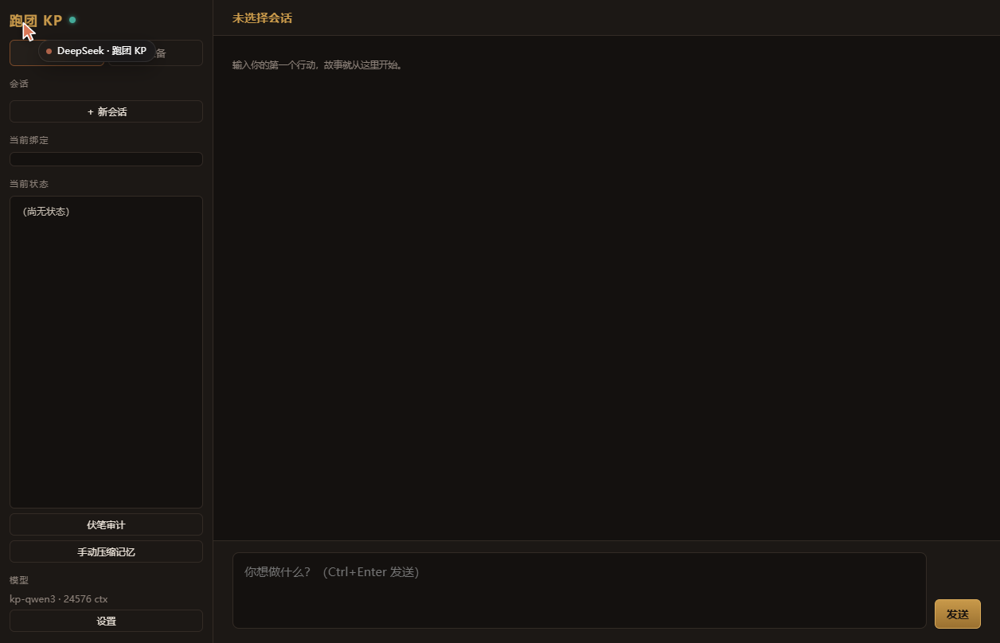

# 跑团 KP

[](LICENSE)
[](requirements.txt)
[](#)

> 原仓库：https://github.com/xiangshu2026/rp-kp
> 如果你是从别处下载的，建议回原仓库获取最新版与 issue 支持。

本地部署的 **COC 7th / DND 5e** 跑团工具。KP（守秘人）用本机 Ollama 跑，
队友可以本地也可以走云端 API。

**特点**：完全本地、不用联网、不花 token 钱（走本地模型时）、模组不塞进上下文。



---

## 立即使用

### 需要什么

- **Python 3.9+**（只用两个第三方库：Pillow + python-docx，`pip install -r requirements.txt` 一次装完）
- **模型**：两种方式二选一
  - **方式 A：本地 Ollama**（免费、离线、需要显卡/内存）
  - **方式 B：任意 OpenAI 兼容 API**（不用显卡，按量付费）

> **没有显卡也能用。** 不想装 Ollama、不想下 18 GB 模型，直接配个 API Key 就能跑，
> 见下面「用云端 API 跑 KP」。

#### 方式 A：本地 Ollama

装 Ollama（https://ollama.com），拉一个模型。`Modelfile` 里的 24K 上下文是按
`qwen3:30b-a3b-instruct-2507-q4_K_M`（约 18 GB，8G 显存 + 32G 内存可跑）调的，
换别的模型要把 `num_ctx` 按显存调一下。
**选哪个模型完全看你自己的偏好**——中文语感、推理能力、速度、显存的取舍不一样。

### 三步跑起来

**0. 装依赖**（只有第一次要，约 10 MB）

```bash
pip install -r requirements.txt
```

只有两个包：`Pillow`（地图识图用）和 `python-docx`（导入 Word 模组用）。
**不需要 GPU、不需要 numpy、不需要任何 LLM SDK** —— 模型调用走标准库 `urllib` 发 HTTP。

**1. 拉模型**（只有第一次要，约 18 GB）

```bash
ollama pull qwen3:30b-a3b-instruct-2507-q4_K_M
ollama create kp-qwen3 -f Modelfile
```

`Modelfile` 已经调好了采样参数和 24K 上下文，直接建就行。

**2. 自检**

双击 `自检.bat`，它会检查三件事：Python 装了没、Ollama 在跑没、`kp-qwen3` 模型在没在。

**3. 启动**

双击 `启动.bat`。浏览器会自动打开 http://127.0.0.1:8760 。
关掉那个黑窗口就退出。

---

## 用云端 API 跑 KP（不用显卡）

不想装 Ollama、不想下 18 GB 模型？直接把 KP 接到任意 **OpenAI 兼容**的 API 上。

### 配置方法

编辑项目根目录的 `config.json`（没有就新建一个）：

```json
{
  "kp_backend": "openai",
  "kp_api_base": "<服务商的 base 地址>",
  "kp_api_key": "<你的 key>",
  "kp_api_model": "<模型名>"
}
```

**不想把 Key 写进文件**？用环境变量：

```powershell
$env:KP_API_KEY = "sk-你的key"
```

配置里 `kp_api_key` 留空时，会自动读 `KP_API_KEY` 环境变量。

### 常见服务商的 base 地址

| 服务商 | kp_api_base |
|---|---|
| DeepSeek | `https://api.deepseek.com/v1` |
| 智谱 | `https://open.bigmodel.cn/api/paas/v4` |
| Moonshot | `https://api.moonshot.cn/v1` |
| OpenRouter | `https://openrouter.ai/api/v1` |
| OpenAI | `https://api.openai.com/v1` |
| 本地 vLLM / LM Studio | `http://127.0.0.1:8000/v1` |

**只要是 `/chat/completions` 接口的都能用**，包括自己搭的 vLLM、Ollama 的 OpenAI 兼容端点。
具体用哪个模型由你决定——不同模型在中文语感、推理深度、速度、价格上差别很大，
按自己的需要挑。

### 切换回本地

把 `kp_backend` 改回 `"ollama"` 即可。两种模式可以随时切，配置互不影响。

### 云端模式的注意点

- **上下文长度受服务商限制**。本地模式默认 24K，云端要看你选的模型支持多少
- **长模组可能超限**。按「幕」装载已经压到 6K 左右，一般够用
- **费用**：按你自己选的模型定价算。一场跑团几十轮，具体花多少取决于服务商和模型

---

## 界面怎么用

### 跑团页

左边「跑团」。会话列表 + 当前绑定 + 世界状态 + 对话区。
顶部「当前绑定」显示这一局用的世界 / 角色卡 / 模组第几幕。

### 角色卡（准备 → 角色卡）

COC 7th 完整车卡：

- 八项属性输入，实时算困难（÷2）与极难（÷5）
- 派生值自动算：HP / MP / SAN / 幸运 / 伤害加成 / 体格 / 移动
- 年龄修正按规则书自动套用
- 55 项技能全表，基础值预填
- 背景七项：性格 / 信条 / 重要之人 / 意义非凡之地 / 珍贵之物 / 旧伤 / 恐惧症
- 「随机生成」一键出卡
- 218 个职业模板，带点数公式

**点数分三类**（界面实时显示剩余）：职业点（按职业公式）、兴趣点（INT×2）、单纯加点（手动填，不占池子）。

### 模组导入（准备 → 模组）

支持 DOCX / PDF / TXT / MD，拖进去或粘贴文本都行。

**关键设计：长模组不塞进上下文。** 导入时按标题自动切成「幕」，运行时只喂：

- 当前幕的正文
- 全部目录（只有标题，几十个 token）
- 上一幕的摘要（你演完一幕手填）
- 下一幕的一句话预告

实测：7.4 万字模组 = 53370 token，整篇塞不进 24576 的窗口。
按幕装载后，单幕 9200 字 = 6624 token，完全装得下。

### 队友（准备 → 队友）

两种来源：

| 来源 | 配置 | 适合 |
|---|---|---|
| 本地 Ollama | 填模型名 | 免费、隐私、不占额度 |
| 云端 API | 选服务商预设 + 填 Key + 模型名 | 质量高、不占显存 |

云端预设内置：DeepSeek / 智谱 / OpenRouter / Moonshot / 自定义（都是 OpenAI 兼容格式）。

**队友拿不到模组原文和世界状态**——只给简版场景（地点 / 时间 / 在场者）和最近 4 轮对话。
这是故意的：队友不该知道玩家不知道的事，否则会剧透。

队友说的话以绿色边线显示在 KP 正文下方。某个队友挂了不影响主线。

### 角色关系（准备 → 关系图）

画布上拖动节点摆位置，右侧下拉选「谁 → 谁 → 什么关系」。
十种关系类型：亲属 / 恋人 / 挚友 / 同事 / 师徒 / 对手 / 仇敌 / 债主债务人 / 隐瞒的秘密 / 其他。

关系会注入 KP 的上下文，并注明「写作时必须遵守」。

### 骰子面板（右上「骰子」按钮）

- 快捷骰：d100 / d20 / d10 / d6 / d8 / 2d6 / 3d6，DND 模式多「优势 / 劣势」
- 自由表达式：`1d100`、`2d6+3`、`3d8-2`
- COC 检定：填技能值 + 奖励骰 / 惩罚骰，自动判成功等级
- DND 检定：填调整值 + DC，自动判大成功 / 大失败
- 伤害骰：填 `1d8+3` 直接掷

结果保存在会话的 `dice.jsonl`。

### 输入标记

玩家输入按标记分类处理：

| 标记 | 含义 | KP 怎么处理 |
|---|---|---|
| 【方括号】 | 强制指令 | 无条件执行，与模组冲突时指令赢 |
| （圆括号） | 行动或心理 | 不写成台词，心理写成内心独白或微表情 |
| 什么都不加 | 说出口的话 / 自主行动 | 当台词引用，或顺着意思推进 |
| OOC / 出戏 / 场外 | 场外商量 | 跳出剧情正常对话 |

### 地图

两种导入方式：

- **图片**：需要本机有视觉模型（`ollama pull qwen2.5vl:3b`，3.2 GB）。没装会明确提示。
- **文字**：格式 `1: 前厅，中央有枯井。通往 2、3`

导入后按房间装载：只喂当前位置的详情 + 全图目录 + 相邻房间。

### 双规则系统

顶栏可切 COC 7e / DND 5e。切换只影响骰子与新建卡，已有卡不受影响。

| | COC 7e | DND 5e |
|---|---|---|
| 判定 | d100 | d20 + 调整值 vs DC |
| 属性 | STR/CON/SIZ/DEX/APP/INT/POW/EDU | STR/DEX/CON/INT/WIS/CHA |
| 成功等级 | 大成功 01-05 / 极难÷5 / 困难÷2 / 普通 / 大失败 96-100 | nat20 / nat1 |
| 理智 | POW 起始，上限 99−神话 | 无（用 WIS 豁免） |

---

## 记忆压缩的语义边界

长团跑到几十轮之后要压缩上下文。这里有个坑：**压缩很容易把长期状态一起冲掉**
（人物、伏笔、HP 全丢，群里的人全部「不认识」了）。

本项目的处理方式：

### 压缩时哪些字段绝对不能碰

代码里有一个显式常量，不是靠注释约定：

```python
STATE_PROTECTED = ("scene", "time", "location", "npcs", "clues",
                   "foreshadow", "resolved", "hp", "next")
```

### 压缩三步走

1. **压缩前**给这些字段拍 sha256 指纹
2. 生成摘要 → **裁剪 turns**（只丢已写进摘要的旧对话，至少保留最近 20 条原文）
3. **压缩后**重新算指纹，不一致就打印警告

### 摘要是「合并」不是「覆盖」

提示词明确要求：

> 已有摘要里的事实必须全部保留，只允许压缩措辞，不允许丢弃事件。
> 超过 600 字时优先压缩早期的场景描写，保留人物、事件、承诺、伏笔。

### 怎么验证

```bash
python test_semantic_boundary.py
```

16 项断言：指纹未变、9 个受保护字段逐个核对、turns 已裁剪但保留最近原文、
裁剪后文件能重新加载、摘要提示词要求保留旧事实。**全部通过。**

---

## 上下文预算

| 项 | token |
|---|---|
| 窗口上限 | 24576 |
| 系统提示词 | ~2560 |
| 世界书（≤8000 字） | ≤5800 |
| 角色卡 | ~185 |
| 模组当前幕 | ~6600 |
| 角色关系 | ~50 |
| 状态层 | ~360 |
| 摘要层 | ~290 |
| 最近 6 轮对话 | ~2600 |
| 输出预留 | 1600 |

中文 1 字 ≈ 0.72 token。**世界书别超 8000 字**，否则和模组同时满配会卡线。

---

## 目录结构

```
rp-kp-app/
├── 启动.bat              双击启动
├── 自检.bat              环境检查
├── server.py             HTTP 服务 + 全部 API
├── engine.py             三层记忆（状态 / 摘要 / 滑窗）
├── coc7.py               COC 7th 规则
├── card_import.py        角色卡导入
├── module_parser.py      模组切分
├── module_store.py       模组存储 + 预算感知装载
├── doc_import.py         PDF / DOCX / TXT 提取
├── teammates.py          队友
├── relations.py          角色关系图
├── dice.py               骰子
├── rules.py              规则系统
├── player_input.py       输入标记解析
├── mapdata.py / map_vision.py   地图
├── skillpoints.py        车卡点数
├── tavern_card.py        酒馆角色卡导入
├── Modelfile             模型封装（只有采样参数）
├── static/               前端
├── worlds/<世界名>/       prompt.md / worldbook.md / characters.md
├── cards/                角色卡
├── modules/              模组
├── sessions/             会话
└── test_*.py             17 个测试脚本
```

---

## 测试

```powershell
Get-ChildItem test_*.py | ForEach-Object { python $_.Name }
```

17 个脚本，全部 `ALL PASS`。**只用标准库，不需要装任何东西。**

---

## 常见问题

**Q：要装什么 Python 包吗？**
A：**不用**。整个项目只用标准库（`http.server`、`json`、`pathlib` 这些）。

**Q：一定要用 qwen3:30b 吗？**
A：不一定。任何 Ollama 模型都能跑，但 `Modelfile` 里的 24K 上下文是按这个模型调的。
换小模型就把 `num_ctx` 调小，不然会 OOM。

**Q：8G 显存能跑吗？**
A：能。`Modelfile` 里 `num_ctx 24576` 就是实测上限，设 32768 会 CUDA OOM。

**Q：数据会上传吗？**
A：**不会**。全部本地文件。只有你自己配了云端队友时，那部分对话才会发到你选的 API。

**Q：模组太长装不下怎么办？**
A：它本来就是按「幕」装的。导入时按标题切分，只喂当前幕。没有标题的模组会被切成一大块，
需要你在原文里加标题（`## 第一幕` 这种）再导入。

**Q：API Key 安全吗？**
A：**明文存在 `teammates.json`**。这是本机文件，不上传任何地方，但别把这个文件分享出去。
界面上显示时打码成前 4 后 4。

**Q：队友太慢？**
A：队友发言是串行的，三个队友 = 三次模型调用。本地跑会明显变慢，想快就让队友走云端。

---

## 已知限制

1. **PDF 只支持文字版**。扫描版图片 PDF 抽不出字，会明确提示「请先 OCR」。
2. **上下文 24576 是硬上限**。8G 显存跑 32768 会 CUDA OOM。
3. **API Key 明文存本机**（见上）。
4. **队友发言串行**，本地跑会慢。
5. **模组切分靠标题**，没标题会被切成一大块。
6. **摘要会重写全文**。长团到 40 轮以上摘要会变啰嗦。
7. **只支持 Windows**（`.bat` 启动脚本）。
8. **示例世界是通用版本**。`worlds/灰石堡/` 里的提示词只提供通用写作规范，
   不含任何特定题材的强制要求。想改风格直接编辑那几个 `.md` 文件——纯文本，改完即生效。
9. **状态块走独立调用兜底**。设计上本来是让模型在正文末尾自带一个 JSON 状态块，
   但实测部分模型会忽略这个要求。所以正文写完后会**再发一次轻量请求**专门填状态。
   代价是每轮多一次调用（几秒、少量 token）；好处是不挑模型。
10. **不同模型的文风差异很大**。有的会写「请选择 1/2/3」、有的会转换人称、
   有的字数超标——这些是模型自身倾向，提示词约束不一定压得住。
   同一个项目换模型，读起来像换了个人，这是正常的。
11. **剧情连贯性依赖固定层质量**。`prompt.md` 写得越具体、`worldbook.md` 设定越细，
   模型越不会跑偏。示例世界是通用模板，实际用建议按自己的团改。

---

## 许可

MIT
